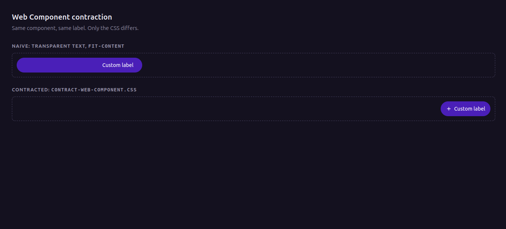

# Web Component Contraction

A small CSS pattern for **re-labelling a third-party button and making its host shrink to the new content**, without the "phantom width" left behind by the original text. Includes a live demo and automated layout and accessibility checks.



Open [`demo/index.html`](demo/index.html) to see both versions side by side: a naive attempt and the contracted result.

## Contents

- [The problem](#the-problem)
- [Quick start](#quick-start)
- [The pattern](#the-pattern)
- [Configuration](#configuration)
- [Accessibility](#accessibility)
- [Tests](#tests)
- [Design notes](#design-notes)
- [Debugging](#debugging)
- [Browser support](#browser-support)
- [Limitations](#limitations)
- [Project structure](#project-structure)
- [License](#license)

## The problem

You can't edit the markup of a component you don't own, so you hide its label with CSS and inject your own. The pill, however, keeps the width of the *original* content, and `width: fit-content` just hugs invisible text.

```css
/* Naive: looks right, but the original text still occupies space */
.label        { color: transparent; font-size: 0; }
.label::after { content: "New label"; color: #fff; font-size: 14px; }
host          { width: fit-content; }
```

## Quick start

1. Copy [`src/contract-web-component.css`](src/contract-web-component.css) into your stylesheet.
2. Replace `x-action-button` with your component's tag name, and adjust the inner class names (`.mdc-button`, `.mdc-button__label`) to match its markup.
3. Set the tokens in `:root` (see [Configuration](#configuration)).

Works anywhere you can inject CSS: a site stylesheet, a browser extension, a test harness.

## The pattern

| Issue | Cause | Fix |
| --- | --- | --- |
| Phantom width | `color: transparent` / `font-size: 0` hide content visually but leave its boxes in layout. `font-size: 0` also misses children that set their own font size. | `display: none` on the native children (`.label > *`); keep `font-size: 0` only for bare text nodes. |
| Host keeps growing | The parent flex container stretches the host (`flex: 1`) and the library sets a `min-width`. | `flex: 0 0 auto`, `width: max-content`, `min-width: 0` on both host and inner button. |
| `fit-content` still too wide | `fit-content` also caps at the available space and behaves oddly on flex items. | Use `max-content` and `max-width: none`. |
| Icon depends on vendor markup | The original icon may be a font ligature or sized in `em`, so it collapses with the label. | Draw your own with `::before`: an inline SVG data URI used as a **mask** over `currentColor`. |

**Why a mask?** A `mask-image` over a `currentColor` background means the icon follows the text color, needs no network request, and doesn't depend on the vendor's icon font.

## Configuration

| Token | Default | Purpose |
| --- | --- | --- |
| `--wc-label` | `"Custom label"` | Injected text |
| `--wc-fg` | `#fff` | Text and icon color |
| `--wc-pad-x` | `14px` | Horizontal padding |
| `--wc-gap` | `6px` | Space between icon and text |
| `--wc-icon` | inline SVG | Icon, as a `url()` data URI |

Because the label is a custom property, it is also handy for **localization stress tests**: set `--wc-label` to a very long or right-to-left string and check that the layout holds.

## Accessibility

Hiding the native label with `display: none` removes it from the accessibility tree, so the button's accessible name comes from the injected `::after` text instead.

In Chromium (verified by the test suite), the contracted button exposes exactly the new label as its accessible name, while the naive version still carries the original text in its name: it *shows* one label and *announces* another.

Keep in mind:

- Support for generated content in accessible-name computation varies across browsers and assistive technologies. Where you control the markup, prefer a real `aria-label`; CSS cannot set one.
- Keep the visible label consistent with what the control actually does.

## Tests

Playwright checks run against the demo page:

- The host wraps the visible pill with no extra space.
- The vendor `min-width` no longer applies.
- The pill is clearly narrower than the naive version.
- The button exposes the new label as its accessible name.

```bash
pip install pytest-playwright
playwright install chromium
pytest
```

Width thresholds are relative, but different fonts can shift them slightly; adjust the ratio in `tests/test_contraction.py` if your environment disagrees.

## Design notes

- **Scoped by tag name.** Every selector is prefixed with the component's custom element, so nothing leaks to other buttons.
- **Stable selectors.** Tag names and library classes (`mdc-*`) survive releases better than generated class names; `> *` avoids naming each native child.
- **`!important` on purpose.** Vendor styles and inline styles would otherwise win.
- **Flat CSS.** No nesting or preprocessor, so it works anywhere.
- **All tweakable values live in one token block.**

## Debugging

```css
x-action-button, x-action-button * { outline: 1px solid red !important; }
```

Shows every box in the component. Look for the element that still carries width or padding.

## Browser support

Uses `max-content`, `mask` (with the `-webkit-mask` prefix as a fallback) and CSS custom properties, all available in current evergreen browsers. Automated tests run on Chromium only; other browsers are untested.

## Limitations

- Needs a component that renders in the light DOM. It cannot reach inside **closed** shadow roots (open roots need `::part()` or a different approach).
- Selectors depend on the target's markup and may need updates when it changes.
- Presentation only: it cannot change behavior.

## Project structure

```
web-component-contraction/
├── README.md
├── LICENSE
├── src/
│   └── contract-web-component.css
├── demo/
│   └── index.html
├── tests/
│   └── test_contraction.py
└── docs/
    └── images/
        └── demo.png
```

## License

[MIT](LICENSE)
